

<picture>
  <source media="(prefers-color-scheme: dark)" srcset="assets/rune-wordmark-dark.svg">
  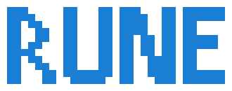
</picture>

# awesome-rune

A curated list of projects built with or for [Rune](https://github.com/anomalyco/rune), a native GPU-rendered Rust UI framework for macOS, Windows, Linux and the web, with its own renderer, text, layout and springs.

[Repository](https://github.com/anomalyco/rune) · [Docs](https://github.com/anomalyco/rune/blob/dev/crates/rune/README.md) · [Components](https://github.com/anomalyco/rune/blob/dev/crates/rune-kit/README.md) · [Examples](https://github.com/anomalyco/rune/tree/dev/examples)

Rune is pre-release, so most projects here pin a <code>dev</code> revision and move fast.

<!-- This file is generated from README.template.md and projects.json. -->
## Featured

<table>
<tr>
<td align="center" valign="top" width="33%">
 
<a href="https://github.com/anomalyco/hex"><b>Hex</b></a> 
 <b>7.8k</b> 
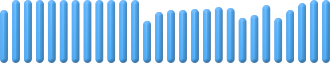 
<code>v3.4.0</code> 10d ago 
Local voice dictation for macOS, Windows and Linux.
</td>
<td align="center" valign="top" width="33%">
 
<a href="https://github.com/kitlangton/psychopomp"><b>Psychopomp</b></a> 
 <b>435</b> 
 
Code-first motion graphics: a small Rust program describes a scene, rendered as 1080p60 video with motion blur or played as an interactive presentation.
</td>
<td align="center" valign="top" width="33%">
 
<a href="https://github.com/anomalyco/deadbolt"><b>Deadbolt</b></a> 
 <b>387</b> 
 
A decentralized password manager: devices sync directly over iroh and join by pairing, with no accounts or servers.
</td>
</tr>
</table>

## Apps

[Developer Tools](#developer-tools) · [Productivity](#productivity) · [Media](#media) · [System Utilities](#system-utilities) · [Games](#games) · [Demos & Examples](#demos--examples)

### Developer Tools

<table>
<tr>
<td align="center" valign="top" width="33%">
 
<a href="https://github.com/RyanLatimer/usage-tracker/tree/master/native"><b>agent-usage</b></a> 
 <b>0</b> 
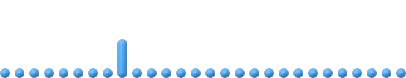 
Native UI for agent-usage: sessions, tokens and API cost summed across every installed coding harness, per harness and per model.
</td>
<td align="center" valign="top" width="33%">
 
<a href="https://github.com/abrudtkuhl/calmtoad"><b>Calm Toad</b></a> 
 <b>1</b> 
 
<code>v0.8.0</code> today 
A desktop website crawler for SEO audits of one host&#x27;s titles, meta descriptions, headings, response codes, canonicals, images and links.
</td>
<td align="center" valign="top" width="33%">
 
<a href="https://github.com/diegoag64/jev-inspector"><b>Jev Inspector</b></a> 
 <b>4</b> 
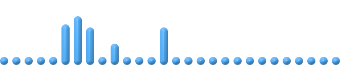 
An experimental native macOS and Windows inspector that runs a local relay in front of TypeSafe API traffic to inspect requests, responses and Jev answers.
</td>
</tr>
<tr>
<td align="center" valign="top" width="33%">
 
<a href="https://github.com/jer-k/layeredgit"><b>layeredgit</b></a> 
 <b>0</b> 
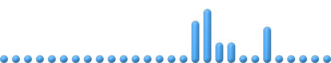 
A local macOS Git viewer that shows committed changes and uncommitted edits together in one diff, so you can review a branch without pushing.
</td>
<td align="center" valign="top" width="33%">
 
<a href="https://github.com/moonframehq/moonframe"><b>Moonframe</b></a> 
 <b>123</b> 
 
<code>v1.4.0</code> today 
A native desktop app factory for malleable Rust and Luau apps that you or an agent reshape while they run, drawn with GPUI in releases and with an experimental Rune renderer from source.
</td>
<td align="center" valign="top" width="33%">
 
<a href="https://github.com/no-phux/phux/tree/main/clients/rune"><b>phux</b></a> 
 <b>23</b> 
 
<code>v0.161.1</code> today 
Alpha desktop client for phux, a terminal multiplexer whose server you can drive from code and that tracks which panes run a coding agent.
</td>
</tr>
<tr>
<td align="center" valign="top" width="33%">
 
<a href="https://github.com/mweinbach/prime-agent-ui"><b>Prime Agent Desktop</b></a> 
 <b>2</b> 
 
<code>desktop-v0.11.0</code> 14d ago 
Unofficial desktop client for Prime Agent that shares the CLI&#x27;s daemon, saved chats and provider credentials.
</td>
<td align="center" valign="top" width="33%">
 
<a href="https://github.com/gooonzick/prism"><b>Prism</b></a> 
 <b>2</b> 
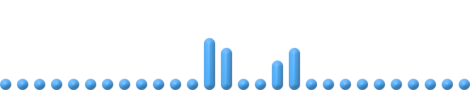 
<code>v0.2.0</code> 10d ago 
A native macOS and Linux app, plus the prism CLI, that manages agent skills and MCP servers across Claude Code, Cursor, Codex and other agents, including on machines reached over ssh.
</td>
<td align="center" valign="top" width="33%">
 
<a href="https://github.com/shuv1337/rex-rune"><b>Rex for Linux</b></a> 
 <b>77</b> 
 
<code>v0.10.1</code> 6d ago 
Unofficial native Linux client for Rex, the terminal multiplexer from Superlogical.
</td>
</tr>
<tr>
<td align="center" valign="top" width="33%">
 
<a href="https://github.com/ImBIOS/t3code-desktop-rune"><b>t3code-desktop-rune</b></a> 
 <b>1</b> 
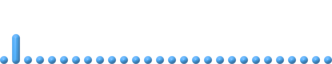 
T3 Code Desktop recreated in Rune for Linux, targeting 1:1 parity with the nightly build.
</td>
</tr>
</table>

### Productivity

<table>
<tr>
<td align="center" valign="top" width="33%">
 
<a href="https://github.com/anomalyco/deadbolt"><b>Deadbolt</b></a> 
 <b>387</b> 
 
A decentralized password manager: devices sync directly over iroh and join by pairing, with no accounts or servers.
</td>
<td align="center" valign="top" width="33%">
 
<a href="https://github.com/adityavardhansharma/EchoSpot"><b>EchoSpot</b></a> 
 <b>0</b> 
 
A native command palette for Hyprland and Omarchy, a Raycast alternative for Linux.
</td>
<td align="center" valign="top" width="33%">
 
<a href="https://github.com/elarisbrowser/elaris"><b>Elaris</b></a> 
 <b>205</b> 
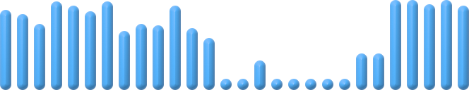 
An early cross-platform browser shell that opens a native window with an editable address bar and an empty content area.
</td>
</tr>
<tr>
<td align="center" valign="top" width="33%">
 
<a href="https://github.com/anomalyco/grim"><b>Grim</b></a> 
 <b>130</b> 
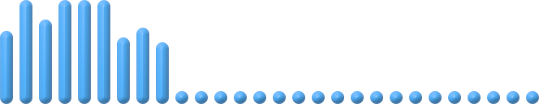 
A multiplayer Markdown notebook for people and agents, with notes stored in Git and a native Mac app.
</td>
<td align="center" valign="top" width="33%">
 
<a href="https://github.com/anomalyco/hex"><b>Hex</b></a> 
 <b>7.8k</b> 
 
<code>v3.4.0</code> 10d ago 
Local voice dictation for macOS, Windows and Linux.
</td>
<td align="center" valign="top" width="33%">
 
<a href="https://github.com/mokmok-dev/koe"><b>koe</b></a> 
 <b>0</b> 
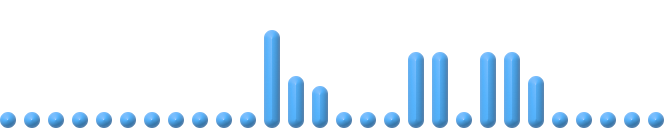 
<code>v2026.11.4</code> 6d ago 
A privacy-first recorder with on-device transcription, system audio and microphone capture, and a menu bar HUD.
</td>
</tr>
<tr>
<td align="center" valign="top" width="33%">
 
<a href="https://github.com/shiroyasha9/kotoba"><b>Kotoba</b></a> 
 <b>3</b> 
 
<code>v0.5.3</code> 18d ago 
Native macOS menu bar dictation: tap a chord, speak, and the transcript is pasted in about a second.
</td>
<td align="center" valign="top" width="33%">
 
<a href="https://github.com/raythurman2386/muninn"><b>Muninn</b></a> 
 <b>3</b> 
 
<code>v0.9.1</code> today 
A local-first Markdown notes app with wikilinks, a graph view and Omarchy theming.
</td>
<td align="center" valign="top" width="33%">
 
<a href="https://github.com/cris7ian/polish"><b>Polish</b></a> 
 <b>0</b> 
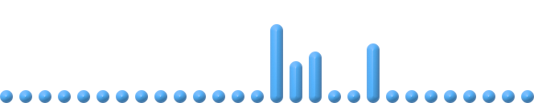 
<code>v1.3.0</code> today 
A small macOS writing app: select text, click a button, and an OpenAI model tidies it. Installs via Homebrew (cris7ian/tap/polish).
</td>
</tr>
<tr>
<td align="center" valign="top" width="33%">
 
<a href="https://github.com/bjarneo/quire/tree/main/desktop"><b>Quire</b></a> 
 <b>87</b> 
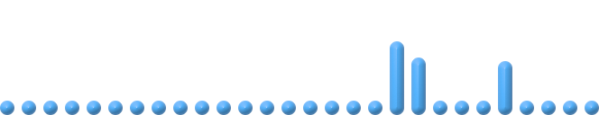 
<code>v0.5.8</code> 3d ago 
A note editor for a plain folder of Markdown files, with a Rune desktop app and an Android app.
</td>
<td align="center" valign="top" width="33%">
 
<a href="https://github.com/JohnDeeZimmermann/rusty-pencil"><b>rusty-pencil</b></a> 
 <b>0</b> 
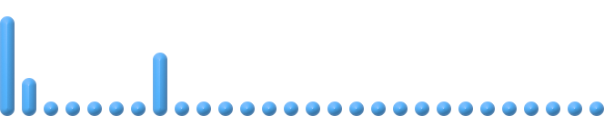 
A cosy, hand-drawn, local-first whiteboard in the spirit of Excalidraw.
</td>
<td align="center" valign="top" width="33%">
 
<a href="https://github.com/duketopceo/WordInk"><b>WordInk</b></a> 
 <b>2</b> 
 
<code>desktop-v1.0.2</code> 13d ago 
AI-powered speech-to-text using Groq&#x27;s API, a Wispr Flow alternative.
</td>
</tr>
<tr>
<td align="center" valign="top" width="33%">
 
<a href="https://github.com/0xQuerencia/x"><b>X</b></a> 
 <b>0</b> 
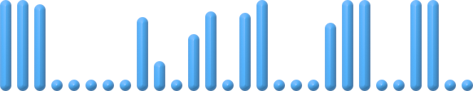 
A fork of Hex for Linux that adds voice commands: open apps, run searches and switch Hyprland workspaces.
</td>
</tr>
</table>

### Media

<table>
<tr>
<td align="center" valign="top" width="33%">
 
<a href="https://github.com/Brendonovich/apps/tree/main/auxcord"><b>Auxcord</b></a> 
 <b>7</b> 
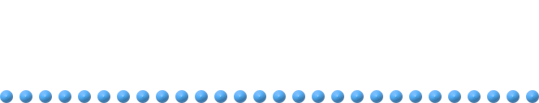 
<code>v0.0.10</code> 29d ago 
Route audio between apps and devices on macOS, including a virtual device other apps can record from.
</td>
<td align="center" valign="top" width="33%">
 
<a href="https://github.com/anomalyco/clip"><b>Clip</b></a> 
 <b>15</b> 
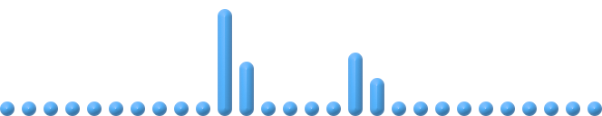 
<code>v0.8.0</code> 16d ago 
Double-tap ⌃ to record your screen, then trim, crop and paste. For macOS.
</td>
<td align="center" valign="top" width="33%">
 
<a href="https://github.com/anomalyco/flicks"><b>Flicks</b></a> 
 <b>11</b> 
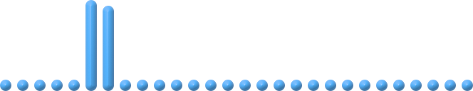 
A lightweight Plex alternative: servers own your folders, and the app merges any number of them into one library. No account, nothing hosted.
</td>
</tr>
<tr>
<td align="center" valign="top" width="33%">
 
<a href="https://github.com/Brendonovich/futhark"><b>Futhark</b></a> 
 <b>0</b> 
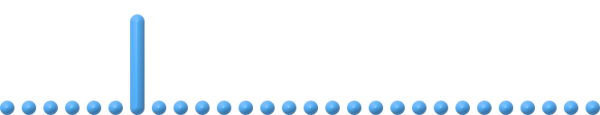 
A TouchDesigner-style realtime node-based visual programming environment.
</td>
<td align="center" valign="top" width="33%">
 
<a href="https://github.com/mustafa89/nightjar"><b>Nightjar</b></a> 
 <b>0</b> 
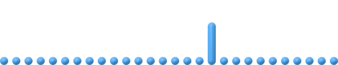 
A skinnable macOS music player with live shader visualizers that plays local files and YouTube Music.
</td>
<td align="center" valign="top" width="33%">
 
<a href="https://github.com/kitlangton/psychopomp"><b>Psychopomp</b></a> 
 <b>435</b> 
 
Code-first motion graphics: a small Rust program describes a scene, rendered as 1080p60 video with motion blur or played as an interactive presentation.
</td>
</tr>
<tr>
<td align="center" valign="top" width="33%">
 
<a href="https://github.com/lifk/Runefin"><b>Runefin</b></a> 
 <b>2</b> 
 
<code>v0.2.2</code> today 
Unofficial Jellyfin client with a desktop and a 10-foot TV layout, a zero-copy GStreamer player and Live TV.
</td>
<td align="center" valign="top" width="33%">
 
<a href="https://github.com/maharshi365/scry"><b>Scry</b></a> 
 <b>0</b> 
 
<code>v0.1.16</code> 15d ago 
A native streaming app for movies and TV, with Stremio add-on support and a built-in player.
</td>
<td align="center" valign="top" width="33%">
 
<a href="https://github.com/alii/sleeve"><b>Sleeve</b></a> 
 <b>21</b> 
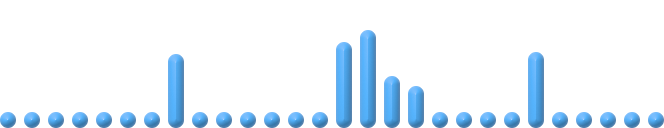 
<code>build-15</code> 3d ago 
Fast DJ USB export software for a rekordbox library, a Rekordbox alternative.
</td>
</tr>
<tr>
<td align="center" valign="top" width="33%">
 
<a href="https://github.com/lopezlav/spotseek/tree/main/ui"><b>Spotseek</b></a> 
 <b>80</b> 
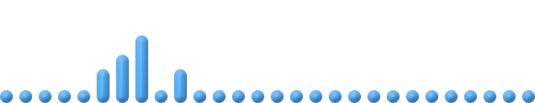 
<code>v0.2.4</code> 11d ago 
Desktop app that downloads Spotify playlists, albums and tracks as mp3 from Soulseek, with YouTube Music for the gaps and a local service for Mixxx progressive playback.
</td>
<td align="center" valign="top" width="33%">
 
<a href="https://github.com/prodBirdy/stremio-rune"><b>stremio-rune</b></a> 
 <b>0</b> 
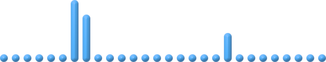 
Native Windows Stremio client.
</td>
<td align="center" valign="top" width="33%">
 
<a href="https://github.com/threehymns/vidshow"><b>vidshow</b></a> 
 <b>0</b> 
 
Show a video to a room: one window holds the controls, and a borderless presenter window covers the display you choose. Decodes with ffmpeg.
</td>
</tr>
<tr>
<td align="center" valign="top" width="33%">
 
<a href="https://github.com/Utility-Gods/wholeseek"><b>Wholeseek</b></a> 
 <b>0</b> 
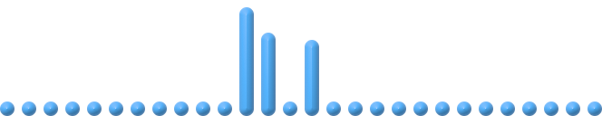 
<code>v0.1.6</code> 6d ago 
A native Linux Soulseek client that plays a track while it downloads, and saves the file only if you keep it.
</td>
</tr>
</table>

### System Utilities

<table>
<tr>
<td align="center" valign="top" width="33%">
 
<a href="https://github.com/nommyt/airbend"><b>Airbend</b></a> 
 <b>0</b> 
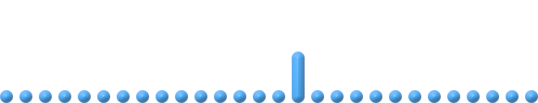 
Linux fan control with custom temperature curves, calibration, NVIDIA GPU fans, Quiet and Performance tray profiles, and Omarchy themes.
</td>
<td align="center" valign="top" width="33%">
 
<a href="https://github.com/ZanzyTHEbar/cirrus-drive/tree/main/crates/cirrus-ui"><b>Cirrus Drive</b></a> 
 <b>1</b> 
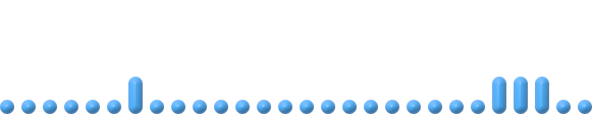 
An early alpha, filesystem-first OpenCloud client for Linux: a daemon mounts Spaces over FUSE, with on-demand chunked reads, offline pins and per-Space sync.
</td>
<td align="center" valign="top" width="33%">
 
<a href="https://github.com/nocdn/drive-mount"><b>Cloud Drive Mount</b></a> 
 <b>0</b> 
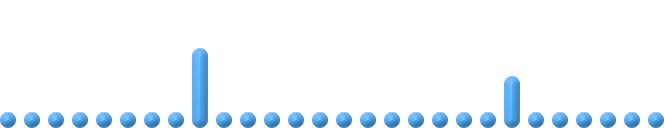 
<code>v1.0.3</code> 6d ago 
Mount cloud storage (B2, Google Drive, seedboxes) as local drives on macOS and Windows, powered by rclone.
</td>
</tr>
<tr>
<td align="center" valign="top" width="33%">
 
<a href="https://github.com/nonlog/Conduit/tree/master/windows/conduit-rune"><b>Conduit</b></a> 
 <b>0</b> 
 
<code>v0.1.25</code> 10d ago 
A small Android ↔ Windows companion for clipboard sync, notifications, file transfer and photo capture toasts.
</td>
<td align="center" valign="top" width="33%">
 
<a href="https://github.com/tbdsux/dscr"><b>DScr</b></a> 
 <b>0</b> 
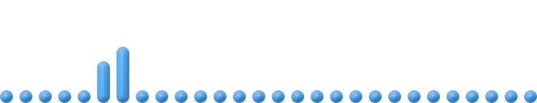 
A small macOS screenshot tool with screen, window and selection modes, delays, global shortcuts and a preview.
</td>
<td align="center" valign="top" width="33%">
 
<a href="https://github.com/anomalyco/hokum"><b>Hokum</b></a> 
 <b>259</b> 
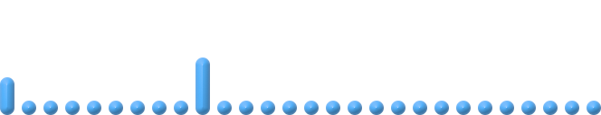 
<code>v0.1.3</code> 23d ago 
A Wayland control center for notifications, sound and Bluetooth, drawn with Rune.
</td>
</tr>
<tr>
<td align="center" valign="top" width="33%">
 
<a href="https://github.com/its4lion/LobbyLocker"><b>LobbyLocker</b></a> 
 <b>4</b> 
 
<code>v0.1.0</code> today 
A beta game server region blocker for Windows 11 and Linux: block unwanted servers for CS2, Deadlock, Overwatch 2, Dead by Daylight, Rocket League (beta), or a custom game.
</td>
<td align="center" valign="top" width="33%">
 
<a href="https://github.com/ItsPotatoTime/Lyre/tree/main/rune-ui"><b>Lyre</b></a> 
 <b>4</b> 
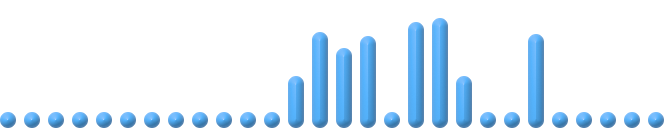 
<code>v0.3.6</code> 3d ago 
A file manager styled like Windows 11 Explorer for Linux and Windows.
</td>
<td align="center" valign="top" width="33%">
 
<a href="https://github.com/OnFireByte/Mojito"><b>Mojito</b></a> 
 <b>0</b> 
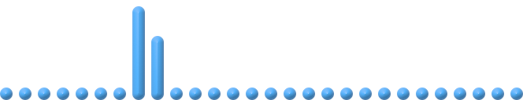 
A macOS shortcut app that turns Caps Lock into a Meta key for arrows, input switching and an app-switching overlay.
</td>
</tr>
<tr>
<td align="center" valign="top" width="33%">
 
<a href="https://github.com/threehymns/sheath"><b>Sheath</b></a> 
 <b>0</b> 
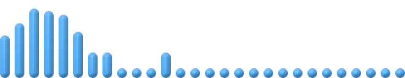 
A cross-platform file manager with a reorderable sidebar, live recursive search, previews and an inspector.
</td>
<td align="center" valign="top" width="33%">
 
<a href="https://github.com/kamal0620040/storix"><b>Storix</b></a> 
 <b>0</b> 
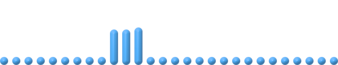 
A fast, native disk cleanup app for Windows: see where the space went, review recommendations and uninstall apps.
</td>
<td align="center" valign="top" width="33%">
 
<a href="https://github.com/ArunPrakashG/yozora/tree/main/shell"><b>Yozora</b></a> 
 <b>0</b> 
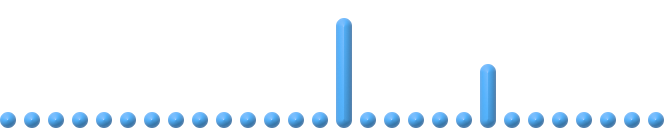 
Alpha desktop shell for Hyprland built with Rune.
</td>
</tr>
</table>

### Games

<table>
<tr>
<td align="center" valign="top" width="33%">
 
<a href="https://github.com/nicognaW/runesweeper"><b>Runesweeper</b></a> 
 <b>0</b> 
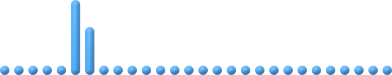 
Minesweeper with the rules and quirks of the Windows classic, drawn with springs, ripples, liquid-metal chrome, fire and shockwaves.
</td>
</tr>
</table>

### Demos & Examples

<table>
<tr>
<td align="center" valign="top" width="33%">
 
<a href="https://github.com/RyanLatimer/carterai"><b>CarterAI</b></a> 
 <b>0</b> 
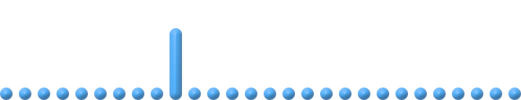 
<code>v0.1.0</code> 17d ago 
Minimal local GPT-2 chat for Apple Silicon with Metal inference and rune-kit components.
</td>
</tr>
</table>

## Libraries

<table>
<tr>
<td align="center" valign="top" width="33%">
 
<a href="https://github.com/anomalyco/rune/tree/dev/crates/rune-fx"><b>rune-fx</b></a> 
 
Official effect layers: glow, pulses, electricity, fire, motion blur, distortion, and fills such as liquid metal and mesh gradients.
</td>
<td align="center" valign="top" width="33%">
 
<a href="https://github.com/anomalyco/rune/tree/dev/crates/rune-kit"><b>rune-kit</b></a> 
 
Official generic, themable components that read only semantic tokens, with the names and variants of `@opencode/ui`.
</td>
<td align="center" valign="top" width="33%">
 
<a href="https://github.com/anomalyco/rune/tree/dev/crates/rune-knobs"><b>rune-knobs</b></a> 
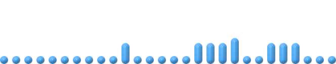 
Official live tuning values: named knobs in groups, and the ⌘⇧K panel that tunes them.
</td>
</tr>
<tr>
<td align="center" valign="top" width="33%">
 
<a href="https://github.com/anomalyco/rune/tree/dev/crates/rune-light"><b>rune-light</b></a> 
 
Official real-time lighting for UIs: SDF soft shadows, bevel normals, god rays and radiance-cascade GI.
</td>
<td align="center" valign="top" width="33%">
 
<a href="https://github.com/anomalyco/rune/tree/dev/crates/rune-mac"><b>rune-mac</b></a> 
 
Official macOS helpers: remembered window frames, full screen, quiet relaunches and system notifications.
</td>
<td align="center" valign="top" width="33%">
 
<a href="https://github.com/threehymns/rune-material-shapes"><b>rune-material-shapes</b></a> 
 <b>0</b> 
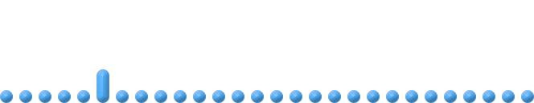 
Material 3 Expressive&#x27;s 35-shape library, ported to Rust and painted with Rune&#x27;s vector shapes.
</td>
</tr>
<tr>
<td align="center" valign="top" width="33%">
 
<a href="https://github.com/anomalyco/rune/tree/dev/crates/rune-mermaid"><b>rune-mermaid</b></a> 
 
Official native Mermaid diagrams: flowcharts, sequence diagrams and state diagrams drawn with Rune shapes and text.
</td>
<td align="center" valign="top" width="33%">
 
<a href="https://github.com/anomalyco/rune/tree/dev/crates/rune-motion"><b>rune-motion</b></a> 
 
Official animation runtime: analytic springs, retargetable tracks, presence, layout and matched-geometry animation.
</td>
<td align="center" valign="top" width="33%">
 
<a href="https://github.com/anomalyco/rune/tree/dev/themes/opencode"><b>rune-theme-opencode</b></a> 
 
Official OpenCode theme that supplies rune-kit&#x27;s semantic tokens.
</td>
</tr>
<tr>
<td align="center" valign="top" width="33%">
 
<a href="https://github.com/khromov/runex"><b>runex</b></a> 
 <b>17</b> 
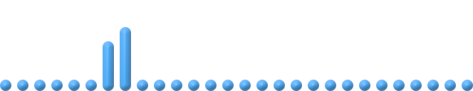 
Node.js and Bun bindings for writing Rune apps in TypeScript, with the same API as the Rust crates.
</td>
</tr>
</table>

## Resources

<table>
<tr>
<td align="center" valign="top" width="33%">
 
<a href="https://github.com/anomalyco/rune/blob/dev/crates/rune/README.md"><b>Rune documentation</b></a> 
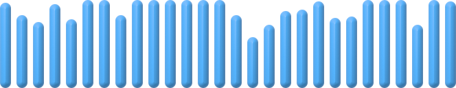 
The official guide to Rune&#x27;s elements, layout, input, motion and headless testing.
</td>
<td align="center" valign="top" width="33%">
 
<a href="https://github.com/anomalyco/rune/tree/dev/examples"><b>Rune examples</b></a> 
 
Official examples, from `hello` and `todo` to a settings window, video player, kit gallery and web builds.
</td>
</tr>
</table>

Stars: gunmetal under 10, rose 10+, silver 100+, gold 1k+. Bars: commits per day over the last 28 days, oldest on the left.

## Contributing

To add a project, edit [`projects.json`](projects.json) and open a pull request. `README.md` is generated.

## License

The list is [CC0 1.0](LICENSE). The badge renderer and Rune's marks keep their MIT license; see [`NOTICE.md`](NOTICE.md).
