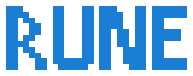

<picture>
  <source media="(prefers-color-scheme: dark)" srcset="assets/rune-wordmark-dark.svg">
  
</picture>

# awesome-rune

A curated list of projects built with or for [Rune](https://github.com/anomalyco/rune), a native GPU-rendered Rust UI framework for macOS, Windows, Linux and the web, with its own renderer, text, layout and springs.

[Repository](https://github.com/anomalyco/rune) · [Docs](https://github.com/anomalyco/rune/blob/dev/crates/rune/README.md) · [Components](https://github.com/anomalyco/rune/blob/dev/crates/rune-kit/README.md) · [Examples](https://github.com/anomalyco/rune/tree/dev/examples)

Rune is pre-release, so most projects here pin a <code>dev</code> revision and move fast.

<!-- This file is generated from README.template.md and projects.json. -->
<!-- PROJECTS -->

## Contributing

To add a project, edit [`projects.json`](projects.json) and open a pull request. `README.md` is generated.

## License

The list is [CC0 1.0](LICENSE). The badge renderer and Rune's marks keep their MIT license; see [`NOTICE.md`](NOTICE.md).
